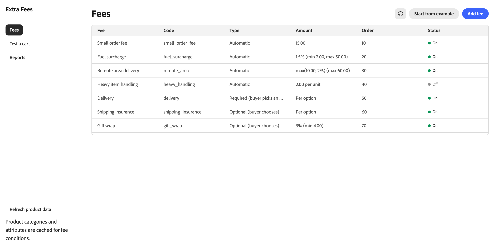
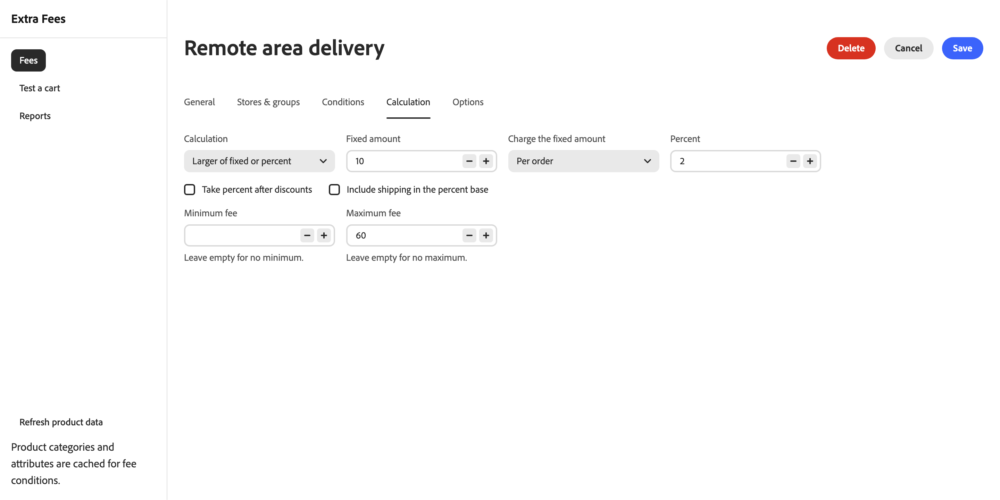
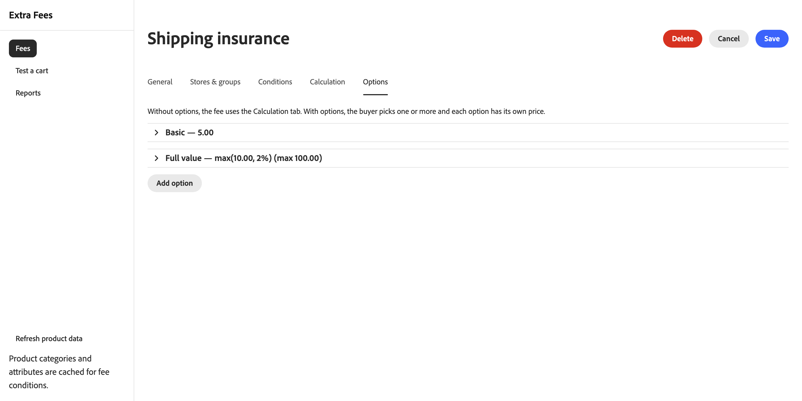
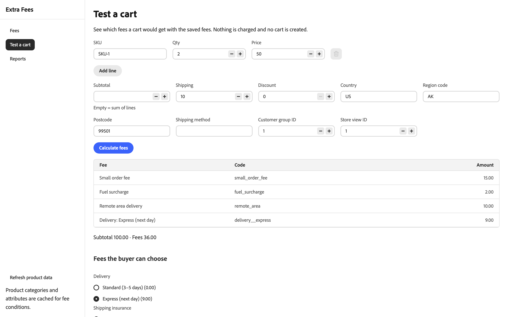
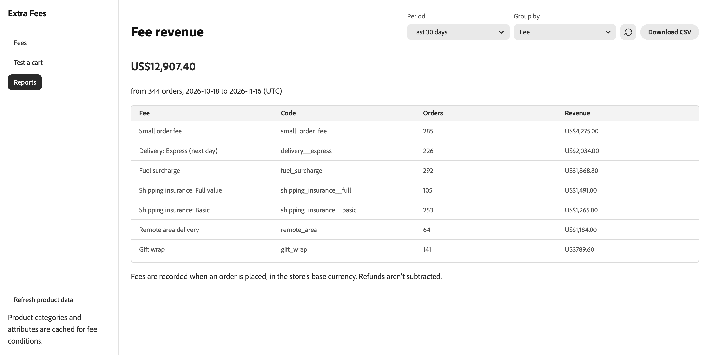

# Extra Fees for Adobe Commerce

[](https://github.com/sohelrana09/commerce-extra-fees/actions/workflows/ci.yml)
[](https://developer.adobe.com/app-builder/)
[](https://business.adobe.com/products/commerce.html)
[](https://nodejs.org/)
[](storefront/README.md)
[](https://github.com/sohelrana09/commerce-extra-fees)
[](LICENSE)

**Rule-based cart and checkout fees for Adobe Commerce, built as an App Builder app.**

Built by [Sohel Rana](https://sohelrana.io), Adobe Certified Master Architect and Claude Certified Architect – Foundations (CCAR-F).

[Quick start](#quick-start) · [Screenshots](#screenshots) · [Documentation](#documentation) · [Rule format](docs/rules.md) · [Storefront kit](storefront/README.md) · [Contributing](CONTRIBUTING.md)

Extra Fees adds the fees merchants used to buy PHP modules for: small-order fees, handling charges, surcharges by region or shipping method, fees for some products, and optional paid services such as gift wrap, insurance or express delivery.

It runs **out of process**, so it works on **Adobe Commerce as a Cloud Service (SaaS)**, where PHP modules can't be installed, as well as on Adobe Commerce on cloud infrastructure and on-premises (PaaS). Commerce calls the app while it collects cart totals, and shows each fee on its own line in the cart, checkout, order, invoice, credit memo and emails.

**Key features**

- **Any number of fees:** fixed, percent, fixed + percent, or the larger of the two; per order, item or unit; with minimum and maximum caps.
- **Precise targeting:** subtotal ranges, store views, customer groups, address, shipping method, quantity, weight, and product SKU, category or attribute.
- **Buyer choices:** optional and required fees as checkboxes, radio buttons or a dropdown, with a priced option each.
- **Admin page:** create, edit and test fees inside the Commerce Admin, with no code.
- **Reports:** fee revenue by fee, day or month, with CSV export.
- **Never blocks checkout:** if anything fails, the app charges no fee and logs the error.
- **Storefront kit:** a block and helpers for Edge Delivery Services storefronts with the Commerce drop-ins.

> **Status: v0.4.0, feature complete.** The rule engine, Admin page, storefront action, reports and database are tested and run on Adobe I/O Runtime. The webhook and event registration, and the storefront kit, still need a check on a live Commerce instance before the Adobe Commerce Marketplace submission. See [Roadmap](#roadmap).



---

## Contents

- [Who it is for](#who-it-is-for)
- [Features](#features)
- [Screenshots](#screenshots)
- [How it works](#how-it-works)
- [Quick start](#quick-start)
- [Configuration](#configuration)
- [Documentation](#documentation)
- [Commands](#commands)
- [Project structure](#project-structure)
- [Roadmap](#roadmap)
- [FAQ](#faq)
- [Contributing](#contributing)
- [License](#license)

## Who it is for

- **Merchants** moving to Adobe Commerce as a Cloud Service who relied on a Magento fee module (small-order fees, surcharges, paid extras) and need the same on SaaS.
- **Agencies and developers** who want a working reference for the out-of-process totals collector, Admin UI SDK pages, App Management, Commerce eventing and App Builder Database Storage in one app.
- **Storefront teams** on Edge Delivery Services who need fee lines and fee choices in the cart and checkout drop-ins.

## Features

| Feature | Supported |
|---|---|
| Any number of fees, each with a label, description, sort order and on/off switch | ✅ |
| Fixed, percent, fixed + percent, or the larger of fixed and percent | ✅ |
| Charged per order, per item or per unit | ✅ |
| Minimum and maximum fee caps | ✅ |
| A subtotal range (for example a small-order fee under $250) | ✅ |
| Percent taken of the subtotal, with or without the discount and shipping | ✅ |
| Limited to store views and customer groups | ✅ |
| Cart conditions: subtotal, quantity, item count, weight, country, region, postcode prefix, city, shipping method, guest or signed-in | ✅ |
| Product filters: SKU, quantity, price, row total, weight | ✅ |
| Product filters: category and product attribute | ✅ (looked up through Commerce REST and cached) |
| Automatic, required and optional fees (checkbox, dropdown, radio, with priced options) | ✅ |
| Storefront kit for Edge Delivery Services: fee choices and fee lines in the cart and checkout | ✅ ([storefront/](storefront/README.md)) |
| Fees for headless storefronts, in GraphQL `cart.prices.custom_fees` | ✅ (Commerce) |
| Fee on order, invoice, credit memo and emails | ✅ (Commerce) |
| Admin page to create, edit, delete and test fees | ✅ |
| Fee revenue reports by fee, day or month, with CSV export | ✅ |
| Rules kept in code (version control) instead of the Admin | ✅ (`FEE_RULES`) |
| Tax on fees | ❌ The custom fees API has no tax field, so fees are untaxed |

## Screenshots

The Admin page, with sample fees and orders.

| Fee editor | Options a buyer can choose |
|---|---|
|  |  |

| Test a cart | Fee revenue report |
|---|---|
|  |  |

These were taken from a local build of the Admin page with sample data, outside the Commerce Admin; the Test a cart results come from the real rule engine.

## How it works

```
Commerce totals collection ──custom fees webhook──▶ calculate-fees ─┐
Storefront (EDS or headless) ──▶ fee-options (public) ──────────────┤
Commerce Admin page (Admin UI SDK) ──▶ rules-*, fee-report ─────────┼──▶ rule engine ──▶ App Builder Database
Order placed (Commerce event) ──▶ record-order-fees ────────────────┤      (rules, choices, product cache,
Daily alarm ──▶ cleanup ────────────────────────────────────────────┘       order fees for reports)
```

Key design choices:

- **One rule engine.** The webhook, the storefront action and the Admin's "Test a cart" all use the same engine (`src/common/fees`), so the price a buyer sees is the price Commerce charges.
- **Fail open.** The webhook answers within Commerce's timeout and never returns an error: a broken rule or a slow lookup means no fee, not a blocked checkout.
- **No custom quote data.** Commerce as a Cloud Service can't store extra data on the cart, so the buyer's choices are saved in App Builder Database Storage, keyed by the cart, and read by the webhook.
- **Least privilege.** Admin actions require the signed-in admin's Adobe IMS token. The only public action is `fee-options`, where the masked cart ID is the credential, as it is for Commerce's own guest cart APIs.
- **Installed by App Management.** Webhook, event subscription, Admin menu, settings and database indexes are declared in `app.commerce.config.ts` and set up when a merchant installs the app.

More detail: [docs/architecture.md](docs/architecture.md).

## Quick start

**You need:** Node.js 24 (`.nvmrc` pins it), the [Adobe I/O CLI](https://developer.adobe.com/app-builder/docs/guides/runtime_guides/tools/cli-install) (`npm install -g @adobe/aio-cli`), an App Builder project, and an Adobe Commerce instance in the same Adobe organization.

1. **Clone and install**

   ```bash
   git clone https://github.com/sohelrana09/commerce-extra-fees.git
   cd commerce-extra-fees
   npm install
   ```

2. **Link your App Builder workspace**

   ```bash
   aio login
   aio console org select
   aio console project select
   aio console workspace select
   aio app use --merge
   cp env.dist .env
   ```

   The workspace needs the I/O Management API, the Adobe Commerce eventing API and App Builder Data Services, and an OAuth Server-to-Server credential ([docs/installation.md](docs/installation.md#app-builder-project)). The installation step provisions its database; `aio app db provision` does it ahead of time.

3. **Deploy**

   ```bash
   aio app deploy
   ```

4. **Install in Commerce**

   In the Commerce Admin, open **Apps → App Management**, find **Extra Fees** and install it. App Management registers the webhook and the order event, adds the **Extra Fees** menu, and creates the database indexes.

5. **Create a fee**

   Open **Extra Fees** in the Admin menu, start from one of the example templates (every one is switched off), and try it in **Test a cart** before you switch it on.

Full guide, including the storefront: [docs/installation.md](docs/installation.md).

## Configuration

Merchants change these in **App Management** after installing:

| Setting | Default | Meaning |
|---|---|---|
| Charge extra fees | On | The master switch. When it's off, the webhook charges no fees. |
| Product data cache (minutes) | 60 | How long product categories and attributes are cached. |

Developers can set these action inputs in `.env` before deploying:

| Variable | Purpose |
|---|---|
| `FEE_RULES` | Optional. A JSON array of rules (or `{ "rules": [...] }`) that **overrides** the rules saved in the Admin, for teams that keep rules in version control. Format: [docs/rules.md](docs/rules.md). |
| `LOG_LEVEL` | Optional. `debug`, `info` (default), `warn` or `error`. At `debug` the webhook logs the fees it applies. |
| `AIO_COMMERCE_AUTH_IMS_*` | The workspace's OAuth Server-to-Server credential, used to call Commerce REST. Filled in by `aio app use`; the Commerce address comes from App Management when the app is installed. Never commit `.env`. |

## Documentation

| Guide | What's in it |
|---|---|
| [Installation](docs/installation.md) | App Builder project, deploy, App Management, webhook and event names, database collections, uninstalling. |
| [Managing fees](docs/admin.md) | The Admin page: fees, Test a cart, Reports, product data, and the web actions behind it. |
| [Rule format](docs/rules.md) | Every rule field, calculation mode, condition and operator, with examples. |
| [Storefront API](docs/storefront-api.md) | The public `fee-options` action for headless storefronts, and reading fees from GraphQL. |
| [Storefront kit](storefront/README.md) | Adding fee lines and fee choices to an Edge Delivery Services storefront. |
| [Architecture](docs/architecture.md) | Actions, data flow, caching, failure handling and security. |

## Commands

| Command | What it does |
|---|---|
| `npm test` | Unit tests with coverage (Vitest). |
| `npm run code:check` / `npm run code:fix` | Lint and format with Biome. |
| `npm run typecheck` | Type-checks the Admin page (TypeScript). |
| `aio app build` | Builds the actions and the Admin page. |
| `aio app deploy` | Deploys to the linked workspace. |
| `aio app db provision` | Creates the workspace's App Builder database ahead of installation (once per workspace). |
| `aio app get-url` | Prints the action URLs, including the storefront's `fee-options`. |

## Project structure

```
app.commerce.config.ts        App Management: webhook, order event, Admin menu, settings
src/common/fees/              the rule engine and data access, shared by every action
    engine.js, conditions.js  rule evaluation and fee calculation
    cart.js                   turns webhook, order and storefront carts into one shape
    rules-repo.js, db.js      rules and collections in App Builder Database Storage
    catalog.js                product category and attribute lookups, cached
    selections.js             buyers' fee choices per cart
    orders.js, reports.js     recorded order fees and revenue reports
src/commerce-extensibility-1/ the extra-fees package: calculate-fees (webhook), fee-options
                              (storefront), record-order-fees (event), cleanup (daily)
src/commerce-backend-ui-2/    the Admin page (React Spectrum) and its ExtraFeesAdmin actions
src/commerce-configuration-1/ App Management settings
scripts/setup-database.js     creates the database indexes on installation
storefront/                   the Edge Delivery Services kit (copied into a storefront repo)
test/                         Vitest: engine, actions, Admin page helpers, storefront kit
docs/                         guides
```

## Roadmap

Done:

1. **Rule engine and webhook:** every calculation mode and condition, with the custom fees webhook.
2. **Admin page:** rules in App Builder Database Storage, an editor with templates, Test a cart, and cached category and attribute lookups.
3. **Storefront:** the public `fee-options` action and the Edge Delivery Services kit.
4. **Orders and reports:** the order-placed event records the fees on each order; revenue reports with CSV export; daily cleanup.

Next:

- Verify on a live Adobe Commerce as a Cloud Service instance: SaaS webhook and event names, the storefront kit end to end, and fees on placed orders.
- Submit to the Adobe Commerce Marketplace.
- Fees by payment method, once the webhook payload carries it.
- Subtract refunds in reports (credit memo events).

Ideas and pull requests are welcome, see [Contributing](#contributing).

### Known limits

- Fees are untaxed, because the custom fees API has no tax field.
- Reports count fees when the order is placed. Credit memos and cancellations aren't subtracted.
- Date and note inputs on fees (as in some Magento fee modules) aren't supported, because Commerce documents couldn't print them.

## FAQ

**Is this an official Adobe product?**
No. Extra Fees is an independent open-source project. Adobe, Adobe Commerce, App Builder and Magento are trademarks of Adobe Inc.

**Does it work on Adobe Commerce as a Cloud Service?**
Yes, that's what it's built for. It uses only extension points that ACCS supports: the out-of-process totals collector webhook, Commerce eventing, the Admin UI SDK and App Management.

**Does it work on Adobe Commerce PaaS or Magento Open Source?**
On Adobe Commerce 2.4.5+ (cloud infrastructure or on-premises) with the Commerce webhooks module and `magento/module-out-of-process-totals-collector`, yes. Magento Open Source doesn't have the webhooks module.

**What happens if the app is down or slow?**
Checkout carries on without the fees. Commerce has a 5-second timeout on the webhook, and the app itself catches every error and answers "no fees".

**Can I keep my rules in Git?**
Yes. Set `FEE_RULES` to a JSON array of rules and deploy. It overrides the rules saved in the Admin.

**Do I need Edge Delivery Services?**
No. Any storefront that reads `cart.prices.custom_fees` from GraphQL shows the fees. The storefront kit only adds ready-made pieces for EDS; headless storefronts call the [`fee-options` action](docs/storefront-api.md) for optional fees.

**Is it production-ready?**
The code is tested (over 160 unit tests, about 97% coverage) and the actions run on Adobe I/O Runtime, but it hasn't run against a live Commerce instance yet. Test it on a staging instance first, and watch the action logs (`aio app logs`) for the first orders.

## Contributing

Bug fixes, new fee conditions, storefront improvements and better documentation are all welcome. For larger changes, open an issue first so we can agree on the approach.

1. Fork the repository and create a branch: `git checkout -b feature/your-change`.
2. Keep business logic in `src/common/fees` with unit tests, and actions thin.
3. Run the checks: `npm run code:check`, `npm run typecheck` and `npm test`.
4. Commit, push the branch and open a pull request that says what changed and how you tested it.

The full guide is in [CONTRIBUTING.md](CONTRIBUTING.md). Please report security problems privately, see [SECURITY.md](SECURITY.md), and follow the [code of conduct](CODE_OF_CONDUCT.md).

## License

[MIT](LICENSE). You may use, change and redistribute Extra Fees, also in commercial projects, as long as the copyright notice stays.

---

Made with Adobe App Builder. If Extra Fees helps you, please give it a star.
