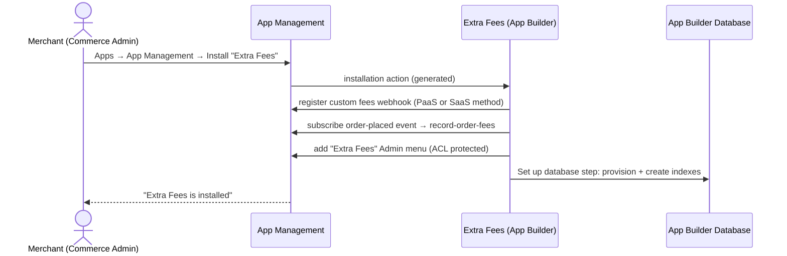
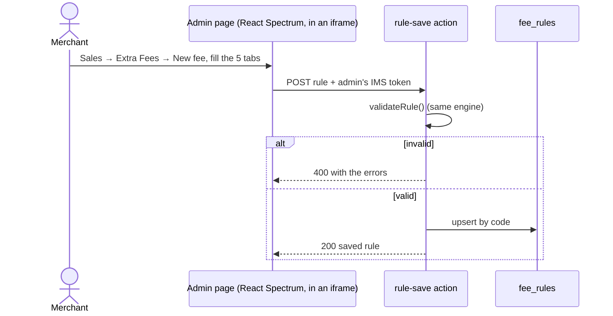
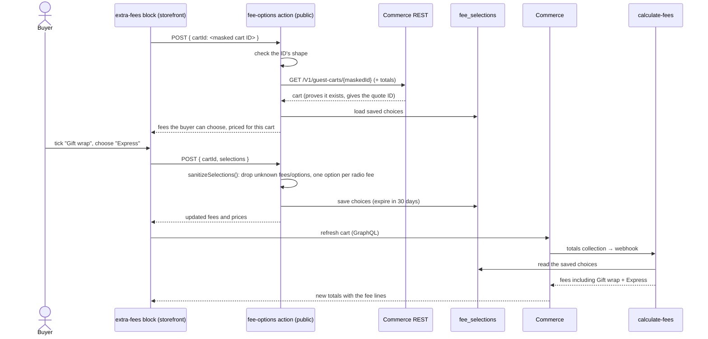
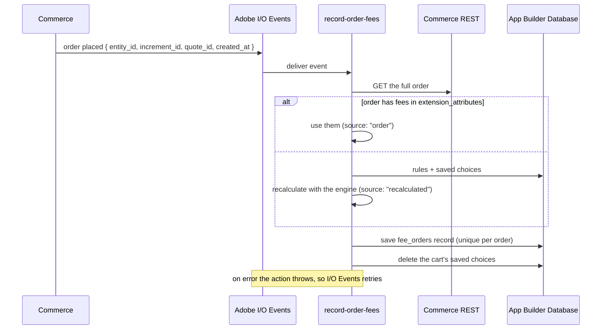

# Extra Fees: implementation walkthrough

This guide explains what was built, how the pieces fit together, how each request flows through the system, and which problems came up along the way and how they were fixed. It's written for someone who wants to understand the app end to end before changing it.

For reference material, see the other guides: [architecture](architecture.md), [installation](installation.md), [rules](rules.md), [Admin page](admin.md) and [storefront API](storefront-api.md).

---

## 1. The problem

Magento stores commonly use a fee module (Amasty Extra Fee, Mageworx Multi Fees, Fooman Surcharge) for small-order fees, surcharges, gift wrap or express delivery. Those are PHP modules that run inside Commerce.

**Adobe Commerce as a Cloud Service (ACCS)** doesn't let you install PHP modules. Anything custom has to run **out of process**, on Adobe App Builder, and talk to Commerce through webhooks, events and APIs.

Extra Fees rebuilds the fee module's features that way. It works on ACCS (SaaS) and on Adobe Commerce PaaS 2.4.5+.

## 2. What was built

| Part | Where | What it does |
|---|---|---|
| Rule engine | `src/common/fees/` | Pure functions that decide which fees apply to a cart and how much each costs. No I/O. |
| Webhook action | `calculate-fees` | Called by Commerce on every totals collection. Returns the fees. |
| Storefront action | `fee-options` | Public API the storefront calls to list optional fees and save the buyer's choices. |
| Order event action | `record-order-fees` | Runs when an order is placed. Saves the fees for reports and clears the saved choices. |
| Cleanup action | `cleanup` | Daily alarm (03:17 UTC). Deletes expired choices and cached product data. |
| Admin page | `src/commerce-backend-ui-2/` | React Spectrum page inside the Commerce Admin: fees list, editor, Test a cart, reports. |
| Admin actions | `rules-list`, `rule-save`, `rule-delete`, `rule-preview`, `lookups`, `catalog-refresh`, `fee-report` | The back end of the Admin page. |
| Settings | `src/commerce-configuration-1/` | Master switch and product cache time, edited in App Management. |
| Install config | `app.commerce.config.ts` | Declares the webhook, event, menu, settings and database step that App Management sets up. |
| Storefront kit | `storefront/` | Files you copy into an Edge Delivery Services storefront: fee lines in cart and checkout, and an `extra-fees` block for choices. |
| Tests | `test/` | 162 Vitest tests for the engine, actions, storefront helpers and report. |

### The three App Builder extensions

`app.config.yaml` includes three extensions:

- `commerce/extensibility/1`: the `extra-fees` actions package (webhook, storefront, event, cleanup) and the generated App Management actions.
- `commerce/backend-ui/2`: the Admin page and its actions.
- `commerce/configuration/1`: the merchant settings.

### Storage

Everything is stored in **App Builder Database Storage**, one database per workspace:

| Collection | Holds | Kept for |
|---|---|---|
| `fee_rules` | Fee rules from the Admin page | Until deleted |
| `fee_selections` | Buyers' choices, keyed by cart (quote ID) | 30 days, or until the order is placed |
| `fee_catalog` | Product categories and attributes by SKU | Cache time in settings (60 minutes by default) |
| `fee_orders` | Fees charged on each placed order | Until the app is uninstalled |

No names, emails or addresses are stored.

## 3. Folder map

```text
app.commerce.config.ts          what App Management installs (webhook, event, menu, settings, DB step)
app.config.yaml                 the three extensions
install.yaml                    APIs listed for the Marketplace
scripts/setup-database.js       install step: provision the DB and create indexes
src/common/fees/
  cart.js                       normaliseCart(): any input → one cart shape
  engine.js                     validateRule(), calculateFees(), describeOptions()
  conditions.js                 cart and item condition trees
  sources.js                    where rules, catalog and choices come from
  rules-repo.js                 rules in the DB, 30-second cache per instance
  selections.js                 buyers' choices: sanitize, save, load, delete
  catalog.js                    product lookup via GET /V1/products, cached
  storefront-cart.js            masked cart ID → webhook-shaped payload
  orders.js                     order → fee record for reports
  reports.js                    report aggregation
  preview.js                    Admin "Test a cart" form → payload
  settings.js                   App Management settings
src/commerce-extensibility-1/actions/
  calculate-fees/               webhook
  fee-options/                  storefront API
  record-order-fees/            order-placed event
  cleanup/                      daily housekeeping
src/commerce-backend-ui-2/
  actions/                      Admin API (handlers.js holds the logic)
  web-src/                      React Spectrum Admin page
storefront/                     EDS kit to copy into a storefront repo
test/                           Vitest tests and fixtures (fake DB, sample payloads)
```

## 4. The core idea: one engine, three callers

The same fee is priced in three places:

1. the **webhook**, when Commerce collects totals;
2. the **storefront action**, which shows buyers the price of each option;
3. the Admin's **Test a cart**, where a merchant checks a fee before switching it on.

If these disagreed, a buyer could see $9 and be charged $12. So each caller turns its own input into one cart shape with `normaliseCart()` and calls the same engine:

```text
 webhook payload ─┐
 storefront cart ─┼─▶ normaliseCart() ─▶ calculateFees() / describeOptions() ─▶ fees
 Admin test form ─┘                         (engine.js + conditions.js)
```

The engine only receives data (rules, cart, catalog, choices) and returns data, so it's easy to test without Commerce.

### How the engine prices one rule

For each enabled rule, sorted by `sortOrder`:

1. **Validate** the rule. An invalid rule is skipped and logged, never charged.
2. **Scope:** the store view and customer group must match (empty means all).
3. **Subtotal range:** `min` inclusive, `max` exclusive.
4. **Cart conditions:** subtotal, quantity, weight, country, region, postcode, shipping method.
5. **Item conditions:** which lines count (SKU, category, attribute), for per-item, per-unit and percent fees.
6. **Type:**
   - `automatic`: always charged when it matches;
   - `required`: charged with the buyer's chosen option, or the default option;
   - `optional`: charged only if the buyer chose it.
7. **Calculate:** `fixed`, `percent`, `fixed_plus_percent` or `max_of` (the larger of the two). The fixed part is multiplied per order, item or unit. The percent base can include the discount and shipping.
8. **Cap** with `min` and `max`, round to 2 decimals, and return `{ code, label, base_fee }`.

## 5. Request flows

### 5.1 Installation (App Management)



Everything App Management registers comes from `app.commerce.config.ts`. The webhook method name differs between PaaS (`plugin.magento.out_of_process_totals_collector...`) and SaaS (`plugin.out_of_process_totals_collector...`), so both are declared with `env: ["paas"]` and `env: ["saas"]`.

### 5.2 Merchant creates a fee (Admin page)



- The Admin page runs inside the Commerce Admin through the **Admin UI SDK**. It gets the signed-in admin's IMS token from the Admin around it, and every Admin action requires that token (`require-adobe-auth`).
- **Test a cart** (`rule-preview`) builds a webhook-shaped payload from the form (`preview.js`) and runs the same `calculateFees()`, so the preview shows exactly what checkout would charge.
- **Lookups** loads store views and customer groups from Commerce REST for the editor's pickers.
- **Refresh product data** (`catalog-refresh`) empties `fee_catalog`.

Rules saved here reach the webhook within 30 seconds, because each running action instance caches the rules list for 30 seconds.

### 5.3 Buyer changes the cart: the fee calculation (the main flow)

```mermaid
sequenceDiagram
  actor B as Buyer
  participant SF as Storefront (EDS)
  participant C as Commerce
  participant W as calculate-fees (webhook)
  participant DB as App Builder Database
  participant REST as Commerce REST

  B->>SF: add item / change qty / set address or shipping
  SF->>C: GraphQL mutation
  C->>C: collect totals
  C->>W: custom fees webhook: { total, quote, shippingAssignment } (IMS auth)
  W->>W: normaliseCart(); empty cart → no fees
  W->>W: settings: master switch off → no fees
  W->>DB: load rules (30 s in-memory cache)
  opt a rule is optional or required
    W->>DB: load buyer's choices for this quote
  end
  opt a rule uses categories or attributes
    W->>DB: cached product data
    W->>REST: GET /V1/products for missing SKUs (50 per call)
  end
  W->>W: calculateFees()
  W-->>C: [{ op: "replace", path: "result/fees", value: [{code,label,base_fee}] }]
  C->>C: add fee lines to totals
  C-->>SF: cart with prices.custom_fees
  SF-->>B: fee lines in cart / checkout summary
```

The webhook's answer is a JSON Patch:

```json
[
  {
    "op": "replace",
    "path": "result/fees",
    "value": [
      { "code": "small_order_fee", "label": "Small order fee", "base_fee": 15 }
    ]
  }
]
```

When no fee applies, it answers a plain `success` operation.

**Failure rule:** any error inside `calculate-fees` is caught, logged, and answered with `success` (no fees). The webhook is registered with a 5-second timeout and a 1-second soft timeout. A lost fee costs a few dollars; a broken checkout costs the order.

### 5.4 Buyer picks an optional fee (storefront → fee-options)

Commerce has nowhere to store "this buyer ticked gift wrap", because ACCS doesn't allow custom quote columns. So the choice is stored in the app's database, keyed by the cart, and the webhook reads it on the next totals collection.



Security notes:

- `fee-options` is **public** (`require-adobe-auth: false`) because buyers don't have an Adobe login.
- The **masked cart ID is the credential**, as it is for Commerce's own guest cart APIs: it's a long random token, and it's checked for shape before any lookup.
- The action **never trusts the browser**: every choice is checked against the rules before it's saved.
- Errors return a generic message and `Cache-Control: no-store`; details go to the logs.

### 5.5 Order placed: recording fees for reports



The write is idempotent per order (`orderId` is a unique index), so a redelivered event does no harm. Unlike the webhook, this action **rethrows** errors, because a retry is the right outcome here.

### 5.6 Reports and cleanup

- **Fee report:** the Admin page calls `fee-report` with a date range and a grouping (by fee, fee and day, or fee and month). It aggregates `fee_orders` per currency. The CSV download neutralises spreadsheet formulas in labels.
- **Cleanup:** the `extra-fees-daily` alarm runs `cleanup` at 03:17 UTC. It deletes expired `fee_selections` and `fee_catalog` entries.

## 6. Storefront integration (Edge Delivery Services)

The app doesn't deploy storefront code. The `storefront/` kit is copied into a storefront repository:

1. **GraphQL:** extend the cart drop-in's `CART_FRAGMENT` in `build.mjs` with `prices { custom_fees { code label amount { value currency } } }`.
2. **Cart model:** `customFeesTransformer` adds `customFees` to the cart data.
3. **Order summary:** `withCustomFees()` inserts one line per fee after gift cards (sort order 700) and before tax (800).
4. **Choices:** the `extra-fees` block calls `fee-options`, renders checkboxes, radios or a dropdown, and refreshes the cart after each change.
5. **Config:** the `fee-options` URL goes in the site config as `commerce-extra-fees-endpoint`.

> The Edgeway storefront was deliberately **not** changed. The kit is generic so any EDS storefront can use it.

## 7. Problems found and how they were fixed

| # | Problem | Cause | Fix |
|---|---|---|---|
| 1 | Saving a new fee returned **500** in the deployed app, though every test passed. | App Builder Database's `findOne` **throws** a `DbError` 404 on a miss instead of returning `null`. The test fake returned `null`. | Added a `findOneOrNull` helper, and changed the fake DB to throw like the real one. |
| 2 | The deploy after `aio app db provision` was rejected. | The command adds a `database` block to `app.config.yaml` that the deploy didn't accept. | Removed the block. The install step (`scripts/setup-database.js`) provisions the DB instead. Lesson: read the diff after running it. |
| 3 | Dependabot's **TypeScript 7** bump passed CI, but a plain `npm install` failed with `ERESOLVE`. | `@adobe/aio-commerce-lib-app` has a peer dependency on `typescript ^6.0.3`. CI uses `npm ci`, which installs straight from the lockfile and didn't notice. | PR #5 restored TypeScript 6, and `dependabot.yml` now ignores TypeScript majors and `@types/node` 25+. |
| 4 | **Babel 8** upgrade broke `aio app build`: `Could not find module "@babel/core" satisfying ^7.12.0`. | The library's build hook installs Babel 7 and writes `.babelrc`, and Parcel's Babel transformer needs `@babel/core` 7. Removing Babel didn't help, because the hook adds it back. | Stayed on Babel 7, closed Dependabot PRs #3 and #4, and Dependabot now ignores `@babel/*` majors. |
| 5 | The Admin page shows only an error when run locally. | `useIms` needs the Commerce Admin around it to supply the admin's login. | Not a bug in the app. For screenshots, a scratch harness served the production build with placeholder credentials and sample data; the Test a cart amounts still came from the real engine. |
| 6 | Admin page titles and sidebar used the browser's **serif** font. | Those elements had no Spectrum font style. | Root uses `font: "body"`, page titles `heading-lg`, sidebar heading `title-lg`. |
| 7 | **Test a cart** sent radio and dropdown fees as checkboxes, so it could pick several options. | The preview rendered every choice as a checkbox. | It now uses a `RadioGroup` for radio and dropdown fees (one option, like the storefront) and right-aligns amounts. |
| 8 | Biome flagged `noNestedTernary` in the preview. | Nested ternaries choosing the input type. | Extracted a `renderChoice()` function. |
| 9 | Category and attribute rules can't work from the webhook payload alone. | The totals webhook sends SKUs, not categories or attributes. | Look products up with `GET /V1/products` (50 SKUs per request), cache them in `fee_catalog`, and only when a rule needs them. The lookup **fails closed**: on timeout, those conditions don't match. |
| 10 | No tax on fees. | The custom fees API has only `code`, `label` and `base_fee`; there's no tax class. | Documented as a known limit: fees are untaxed. If tax is required, include it in the amount and say so in the label. |
| 11 | Nowhere to store a buyer's optional-fee choice. | ACCS doesn't allow custom data on the quote. | Store choices in `fee_selections`, keyed by quote ID, written by `fee-options` and read by the webhook. |

### Configuration notes that matter

- Actions that call Commerce REST carry `include-ims-credentials: true`, so Runtime passes the workspace's OAuth Server-to-Server credential to the action. That credential never reaches the browser.
- `aio-commerce-lib-app` regenerates the App Management sections of the config on build. Don't edit the parts marked "auto-generated".
- Webhook and event names differ between PaaS and SaaS. Confirm the SaaS webhook name on a real instance with `GET /V1/webhooks/supportedList`.

## 8. Status and what's left

**Done**

- v0.4.0 released (tag at `9cbb945`), MIT-licensed, public repo with CI (Biome, type check, tests).
- Deployed to App Builder Stage and Production workspaces; actions tested on Adobe I/O Runtime.

**Not done yet**

- **Installed and run end to end on a live ACCS instance.** The available Commerce is an Adobe demo sandbox without Admin access, so App Management installation, the SaaS webhook and event names, the storefront kit, and fees on real orders are still unverified.
- Submit to the Adobe Commerce Marketplace.
- Subtract refunds in the report; fees by payment method once the webhook payload carries it.

## 9. Website changes (sohelrana.io)

These went to the separate `sohel-site` repository:

- **Article:** "I rebuilt a Magento fee module as an App Builder app for Adobe Commerce as a Cloud Service. Here are 6 lessons." at `/writing/extra-fees-app-builder`, with three Admin screenshots.
- **Products page:** Extra Fees is listed second on `/products`, after commerce-b2b-mcp, and linked from the home page's "Other work" line. The home page keeps two product cards so the grid stays even.
- **Hydration warning fix:** the Next.js dev overlay reported a hydration mismatch on `<body>`. The extra attributes (`data-gr-ext-installed`, `data-new-gr-c-s-check-loaded`) are added by the **Grammarly** browser extension before React loads, so they weren't in the server HTML. The fix is `suppressHydrationWarning` on `<body>` in `src/app/layout.tsx`, which ignores attribute differences on that one element only. `<html>` already had it for the theme script.
